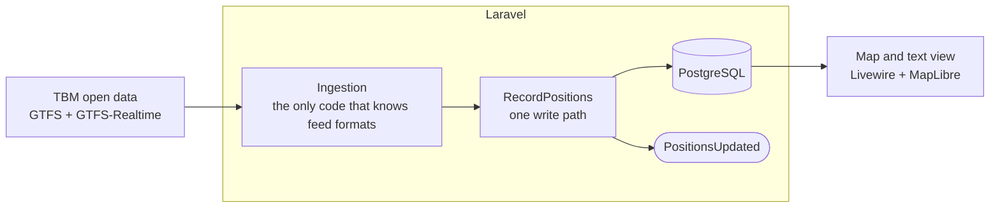

# balise

**Where is my tram, right now?** balise reads the live positions that transit networks publish as GTFS-Realtime, cleans them, and draws every bus and tram on a map, moving. First network: TBM, in Bordeaux.

[](https://github.com/k1n0b0n/balise/actions/workflows/ci.yml)
[](LICENSE)


## What you get

- 🚋 **About 400 vehicles live at midday**, read from the feed every 20 seconds, coloured by line and shaped by mode.
- 🗺️ **The whole network under them:** 202 lines drawn faintly on an open basemap, no API key.
- 🎯 **Pick a line or a vehicle** and the map shows it, then stays still; a popup goes with the vehicle and tells its line and how old its position is.
- ♿ **A text view equal to the map**, and a pause button: the map is not the only way in (RGAA AA).
- 🌱 **A light page:** EcoIndex A (86/100), JavaScript budget checked in CI.

## Run it in two commands

```sh
docker compose up -d
docker compose exec php php artisan network:import tbm
```

Open http://localhost:8000. Nothing to install but Docker: PHP, Node, PostgreSQL and the scheduler that polls TBM all run in containers.

Quality gates (Pint, Larastan at level max, Pest with browser and accessibility tests): `docker compose run --rm test`. Every other command is in [AGENTS.md](AGENTS.md#commands).

## How it works



- **Feed formats stay at the edge.** Only `App\Ingestion` knows GTFS, GTFS-Realtime or protobuf; an architecture test fails the build otherwise. A new network is configuration, a new standard is one adapter.
- **One way to write a position.** Every write goes through `RecordPositions`, which emits `PositionsUpdated`: live push (Reverb) and history plug in as listeners.
- **Stale data is dropped, not shown.** Some TBM positions are hours old; anything older than 5 minutes is filtered out.

## Read the decisions, not only the code

Every choice that is costly to reverse has an [ADR](docs/adr/), from the [feed boundary](docs/adr/0001-feed-ingestion-ports.md) to [hosting](docs/adr/0020-docker-hosting.md). The work runs one story at a time from a [PRD](docs/prd.md), with AI agents writing code and a human reviewing every diff ([how](docs/README.md)).

| Document | What it holds |
|---|---|
| [docs/brief.md](docs/brief.md) | The problem, the audience, the MVP |
| [docs/prd.md](docs/prd.md) | Epics and stories with acceptance criteria |
| [docs/architecture.md](docs/architecture.md) | Stack and components, one line per decision |
| [docs/deploy.md](docs/deploy.md) | From a fork to a release on a Debian or Ubuntu host of your own |
| [docs/stories/](docs/stories/) | What each story did and what it taught |

## Next

Vehicles grouped by line and destination, releases deployed automatically to a public server, then live push over WebSockets with Laravel Reverb.

## License and data

Code under the [MIT license](LICENSE) ([ADR-0003](docs/adr/0003-license.md)). Data: Bordeaux Métropole, *Réseau urbain et scolaire TBM*, from [transport.data.gouv.fr](https://transport.data.gouv.fr/datasets/offres-de-services-bus-tram-et-scolaire-au-format-gtfs-netex-gtfs-rt-siri-lite), under the Licence Ouverte.
