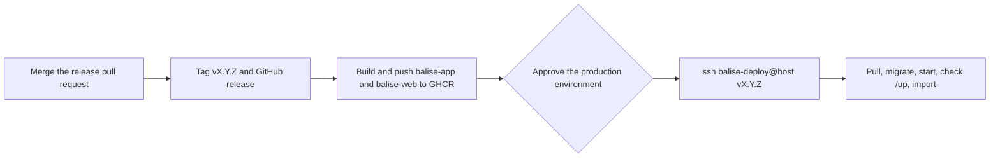

# Deploying balise

From a fork to a release running on a host of your own (ADR-0020). The host is prepared once by a person; after that,
every release published on GitHub is built, pushed and, once you approve it, deployed by GitHub Actions.



## What you need

- A host running **Debian 13 or Ubuntu 26.04**, reachable over SSH by an admin user who can `sudo`. It may already run
  other sites and containers: the bootstrap adds one nginx site and leaves the rest alone.
- A **domain name** whose DNS points at the host, for the certificate.
- A **fork** of this repository, with Docker on your machine. Ansible runs in a container (`docker compose run --rm ansible`).

## 1. Create the deploy key

The release workflow reaches the host with a key that can run nothing but the deploy script.

```sh
ssh-keygen -t ed25519 -N '' -C balise-deploy -f ~/.ssh/balise-deploy
```

## 2. Describe your host

```sh
cp ansible/inventory/example.yml ansible/local/inventory.yml
```

Fill in `ansible/local/inventory.yml`, which Git ignores: host and SSH user, `domain`, `certbot_email`, the content of
`~/.ssh/balise-deploy.pub` as `deploy_public_key`, `image_repository` (`ghcr.io/<your GitHub name>/balise`), a free
local `web_port`, and whether the bootstrap manages the firewall and unattended upgrades. The Ansible container only
sees the repository. With Docker Desktop or a similar tool, it can use your SSH agent instead of a key file: add
`-v /run/host-services/ssh-auth.sock:/run/host-services/ssh-auth.sock -e SSH_AUTH_SOCK=/run/host-services/ssh-auth.sock`
after `run --rm` in the commands below. Otherwise put the admin user's SSH key under `ansible/local/` and name it in
`ansible_ssh_private_key_file`. Copy the host's line of your `known_hosts` there too (`ssh-keygen -F`), and point
`ansible_ssh_common_args` at it with `-o UserKnownHostsFile=/var/www/balise/ansible/local/known_hosts`.

## 3. Prepare the host

On a host that already serves other things, look first:

```sh
docker compose run --rm ansible ansible-playbook -i local/inventory.yml host.yml --check --diff
```

Then apply; a second run changes nothing:

```sh
docker compose run --rm ansible ansible-playbook -i local/inventory.yml host.yml
```

The host then has Docker, nginx and certbot (installed from the distribution's archive only when missing), the site
`/etc/nginx/conf.d/balise.conf` with its certificate, the user `balise-deploy` restricted to
`/usr/local/sbin/balise-deploy`, and `/srv/balise`:

| Path | What |
|---|---|
| `compose.yaml` | The production services: `php`, `queue`, `scheduler`, `web` (on `127.0.0.1:<web_port>`), `postgres`, `redis` |
| `app.env`, `postgres.env` | The containers' environment; the application key and database password are generated there and never leave the host |
| `.env` | The versions of the running release, written by each deploy |
| `releases` | The deployed versions, the current one last |
| `dumps/` | PostgreSQL dumps made when a release moves to a new major |

## 4. Set up GitHub

1. **Release-please's GitHub App**, so that its releases start the deploy workflow: see ADR-0004 and
   [`release.yml`](../.github/workflows/release.yml) (`RELEASE_APP_CLIENT_ID` variable, `RELEASE_APP_PRIVATE_KEY` secret).
2. **The `production` environment** (*Settings → Environments → New environment*): add yourself as a required
   reviewer, and allow only tags matching `v*` under *Deployment branches and tags*.
3. **Its secrets**, from your machine:

   ```sh
   gh secret set DEPLOY_SSH_KEY --env production < ~/.ssh/balise-deploy
   gh secret set DEPLOY_HOST --env production --body "<host>"
   gh secret set DEPLOY_PORT --env production --body "<SSH port>"
   ssh-keyscan -p "<SSH port>" "<host>" 2> /dev/null | gh secret set DEPLOY_KNOWN_HOSTS --env production
   ```

   The host's name and port are secrets rather than variables: the Actions logs of a public repository are public, and
   only secrets are masked in them.

## 5. Release

Merge the pull request `chore: release x.y.z` that release-please keeps open. The tag and the GitHub release start the
**Deploy** workflow: it builds both images for `linux/amd64`, pushes them to GHCR, then waits for your approval.

The host pulls both images without credentials, so they must be public. Pushed from a public repository with its
`org.opencontainers.image.source` label, they were public from the first release here; check before approving that
`docker pull ghcr.io/<your GitHub name>/balise-app:vX.Y.Z` and the same for `balise-web` work logged out, and otherwise change their visibility
(*your profile → Packages → balise-app and balise-web → Package settings → Change visibility*).

Approve, and the job runs `balise-deploy vX.Y.Z` on the host:

1. pulls both images and reads the PostgreSQL and Redis majors from their labels;
2. stops the queue worker and the scheduler, moves PostgreSQL by dump and restore if its major changed, migrates;
3. starts every service on the new version;
4. checks `/up` for 30 s, and starts the previous version again if it fails;
5. imports the networks' lines and stops (nothing when the provider's data is unchanged);
6. keeps the images of the last three versions.

## By hand

Through the deploy key, from a machine that holds it:

```sh
ssh -i ~/.ssh/balise-deploy balise-deploy@<host> v1.2.3     # deploy an existing release
ssh -i ~/.ssh/balise-deploy balise-deploy@<host> rollback   # start the previous version again
```

A rollback goes back one version, the one whose migrations the current release promises to keep working (ADR-0020
point 8); a second rollback in a row is refused. To go further back, name the version, once its migrations allow it:
none of the releases in between may have dropped what it reads.

As the admin user on the host:

```sh
sudo docker compose -f /srv/balise/compose.yaml ps
sudo docker compose -f /srv/balise/compose.yaml logs -f php queue scheduler
sudo tail -n 50 /var/log/balise-deploy.log
```

A deploy runs as the systemd unit `balise-deploy` and writes to `/var/log/balise-deploy.log`; the SSH session only
follows it, so cancelling the workflow or losing the connection does not stop a deploy halfway.

## Feed recordings

With `recordings: true` (the default), the scheduler records the vehicle feed in the `balise-recordings` volume and
archives each finished service day into `balise-recording-archives` at `recordings_archive_at` (05:15 by default, in the
network's time zone): pick a time clear of the host's own nightly updates and reboots, since a missed run waits for the
next night. The last 30 archives and their list are public at `https://<domain>/recordings/index.json`, one download at a
time per address at 5 MB/s (ADR-0022). Both volumes survive deploys; removing them loses only past recordings.

## Moving PostgreSQL or Redis to a new major

Change the image tag in `compose.yaml` (the local stack), check it locally, and release. The deploy reads the new
major from the image's labels; for PostgreSQL it dumps the database with the old major into `/srv/balise/dumps/`,
starts the new one on a new volume, restores the dump, and removes the old volume once `/up` answers. A rollback
across majors does the same in the other direction. Redis holds nothing that does not rebuild itself.

## Trying it on local machines

`scripts/local-server.sh` creates local machines that stand in for hosts (ADR-0020 point 9), described by
`ansible/inventory/local.yml`. Test releases are built on the workstation and pushed to a registry there:

```sh
docker run -d --name balise-registry --restart unless-stopped -p 5000:5000 registry:3
sh scripts/local-server.sh debian
docker compose run --rm ansible ansible-playbook host.yml
docker build -f docker/php/Dockerfile --target production --build-arg POSTGRESQL_VERSION=18 --build-arg REDIS_VERSION=8 -t localhost:5000/balise-app:v0.1.0 .
docker build -f docker/nginx/Dockerfile --target production --build-arg APP_IMAGE=localhost:5000/balise-app:v0.1.0 -t localhost:5000/balise-web:v0.1.0 .
docker push localhost:5000/balise-app:v0.1.0 && docker push localhost:5000/balise-web:v0.1.0
ssh -i ansible/local/id_ed25519 balise-deploy@balise-debian.orb.local v0.1.0
```

The site is then at http://balise-debian.orb.local.
